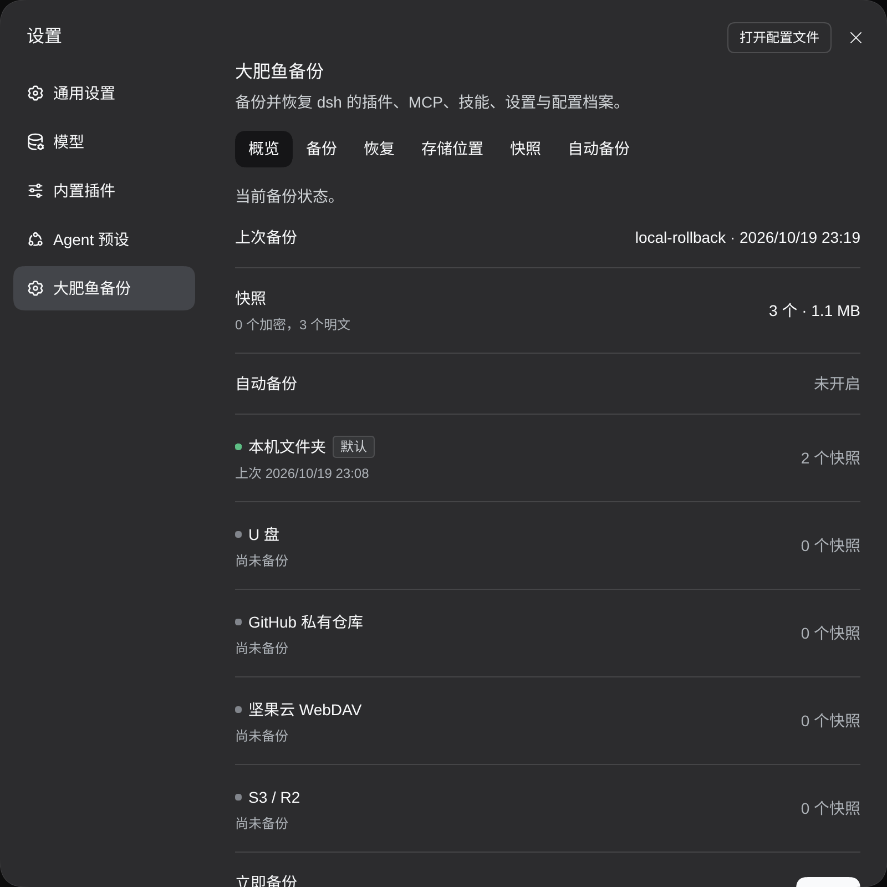
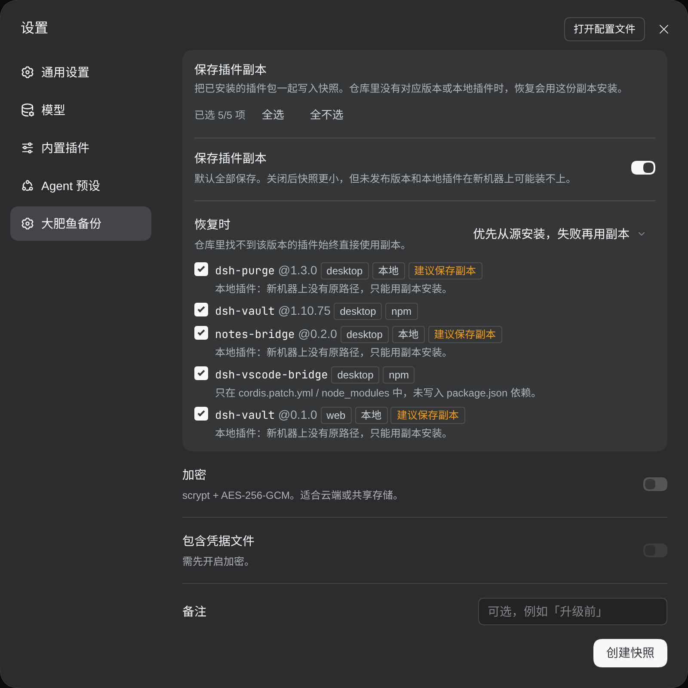
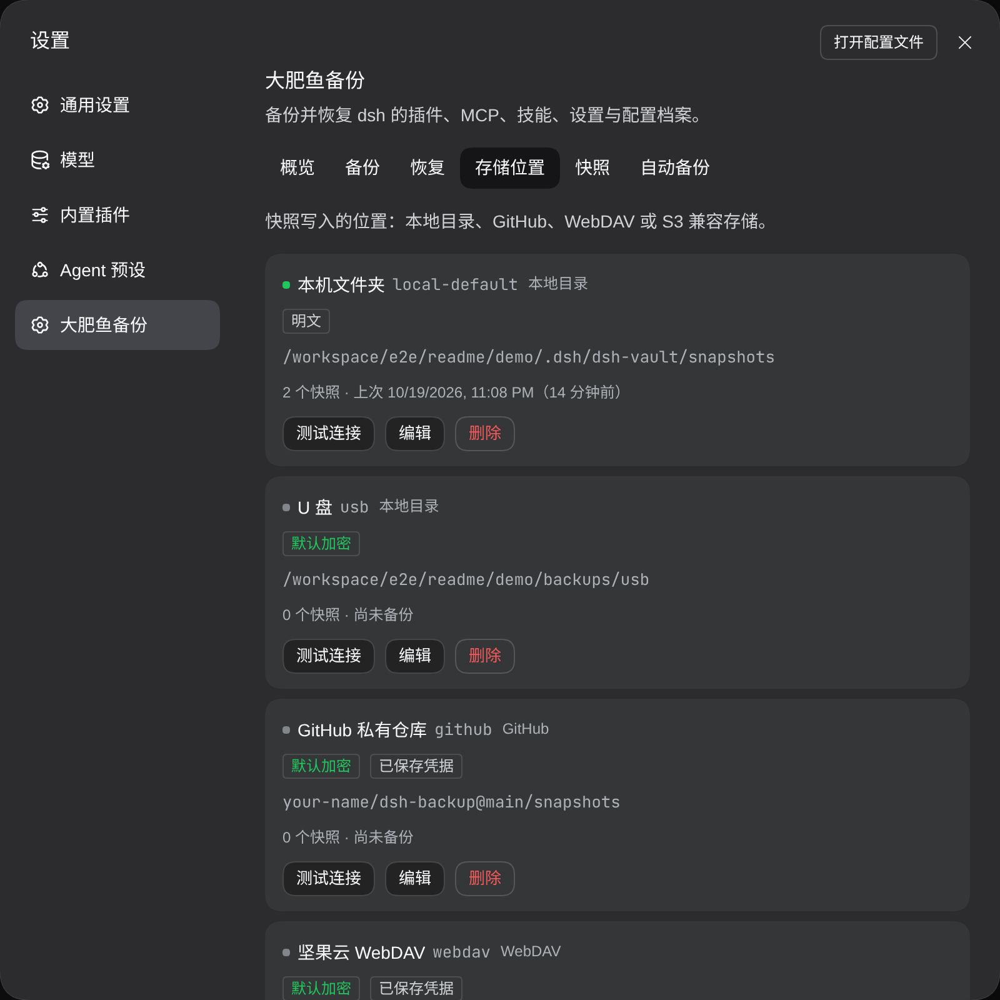
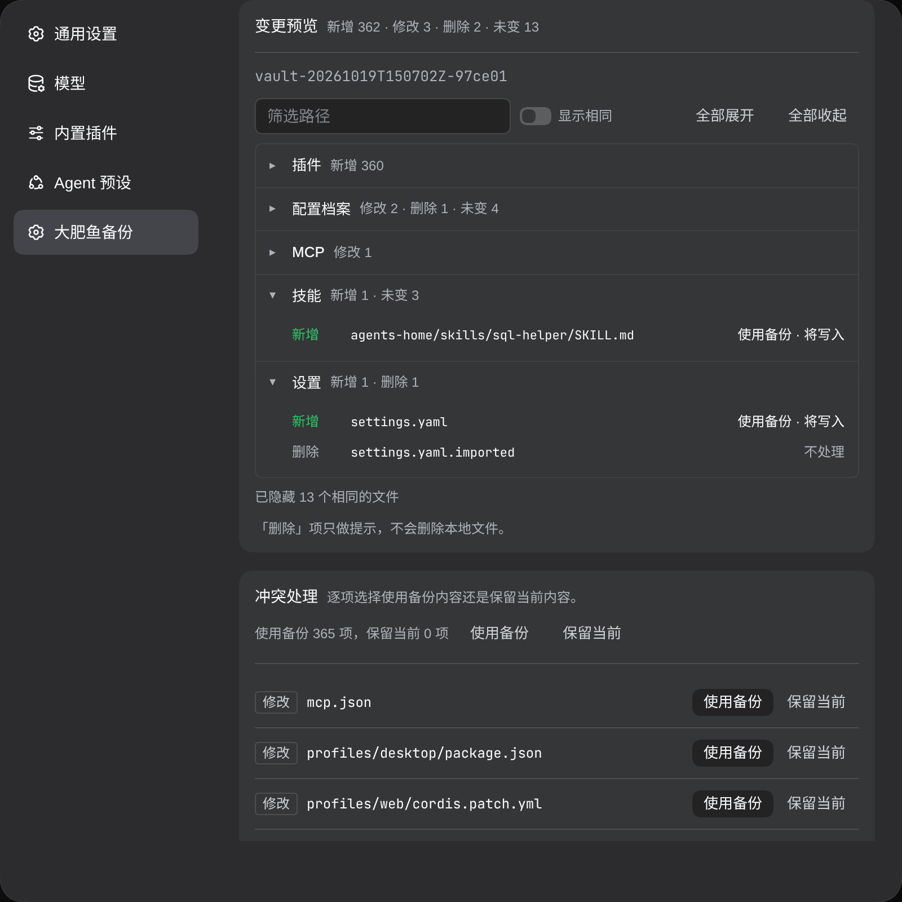
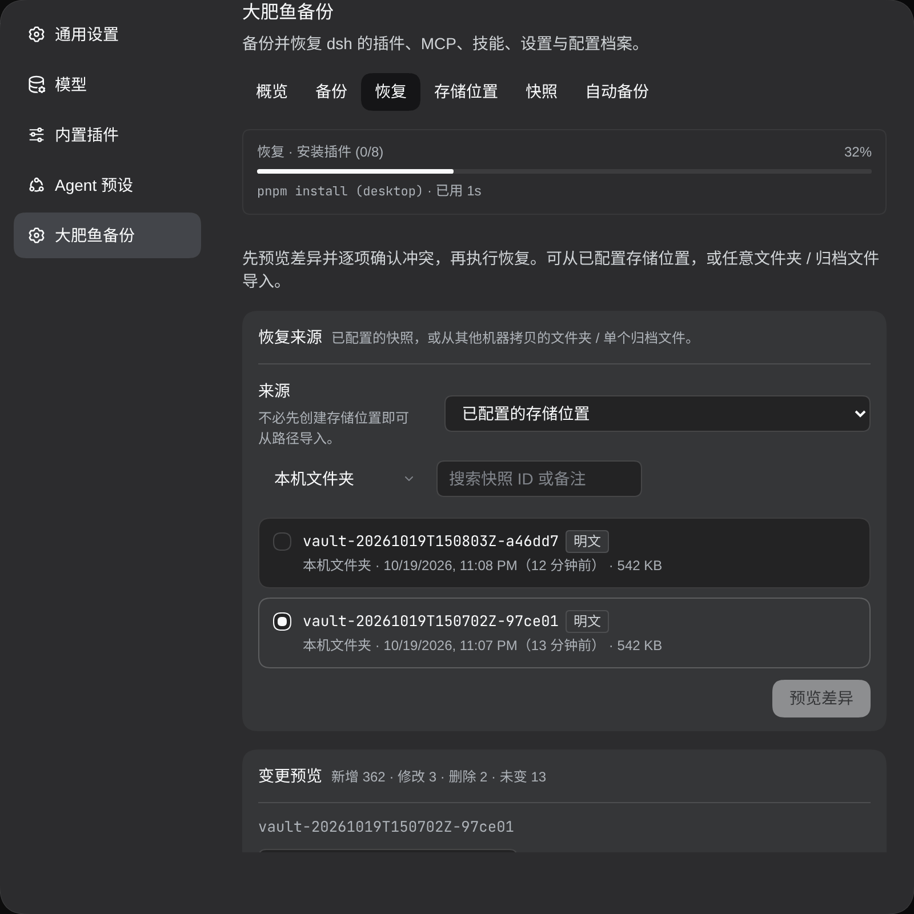
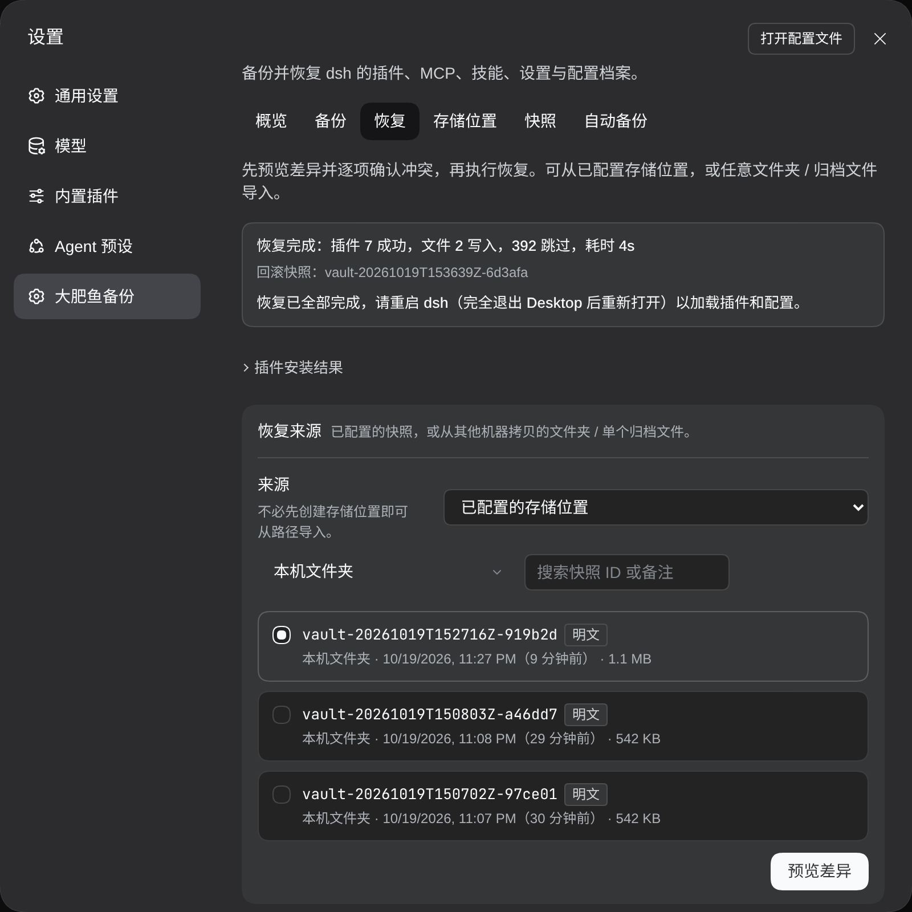
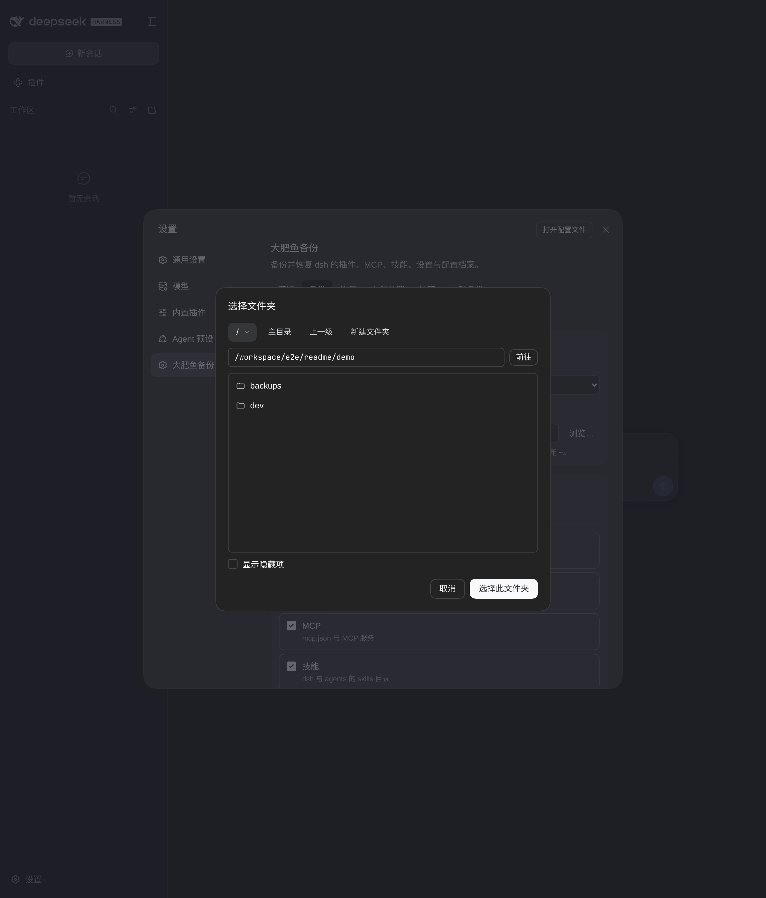

<div align="center">

# dsh-vault · 大肥鱼备份

把整套 DeepSeek Harness（`dsh`）环境备份下来，在另一台电脑上原样恢复：插件相同，版本相同，配置相同。

[English](./README.md) · **简体中文**

[](./LICENSE)




</div>

## 为什么做这个

把 dsh 搬到新电脑，通常意味着：一个个手动重装插件，回忆当时装的是哪个版本，重新添加 MCP，来回拷技能和预设，再把模型服务商重新填一遍。有些插件来自 GitHub fork 或本地文件夹，换台机器就装不回来。

dsh-vault 把这件事变成三步：旧电脑上备份，新电脑上恢复，重启。

它是 dsh 里的一个设置页（**设置 → 大肥鱼备份**），DeepSeek Harness Desktop 和 `dsh web` 都能用；另外带一个命令行，dsh 界面打不开时也能用。

## 功能

- **备份整个 `$DSH_HOME`**，自动排除 `node_modules`、缓存、日志和聊天记录。完整排除列表见 `dsh-vault excludes`。
- **按原版本重装插件**。按原来的来源（npm 版本、`github:` 引用、`link:` 路径）重装，使用 Desktop 自带的 pnpm，系统里不用装 Node 或 pnpm。
- **插件副本**。可以把已安装的插件包一并存进快照。版本被撤回、GitHub 仓库没了、新电脑上没有那个本地文件夹时，就从副本安装。逐个插件选择，最可能需要副本的会被标出来。
- **存储位置**：本地文件夹（明文 `.tar.gz` 或 AES-256-GCM 加密的 `.dshvault`）、GitHub 私有仓库、WebDAV（坚果云、Nextcloud 等）、S3 兼容存储（S3、R2、MinIO、OSS）。
- **导出单个文件**到 U 盘或任意目录；恢复时可直接从任意文件夹或文件导入，不需要先配置存储位置。
- **恢复前预览差异**，按类别分组、可折叠，冲突可以逐个文件选择。
- **每次恢复前自动生成回滚快照**。
- **真实进度**：备份、恢复、插件安装都有进度条。
- **只重试失败的插件**，不会重写配置。
- **定时自动备份**。
- **聊天记录和工作区刻意不迁移**：体积大、和机器绑定，而且包含绝对路径。
- 支持 Windows、macOS、Linux。

## 截图

| 备份：选择哪些插件保存副本 | 存储位置 |
|---|---|
|  |  |
| **恢复：差异预览** | **恢复进行中** |
|  |  |
| **恢复完成** | **内置文件夹浏览器** |
|  |  |

如果有插件安装失败，结果会写明失败个数并提供重试：[restore-partial.png](docs/screenshots/restore-partial.png)。浅色主题跟随 dsh：[overview-light.png](docs/screenshots/overview-light.png)。

## 安装

### 在插件页添加（推荐）

在 DeepSeek Harness Desktop（或 `dsh web`）中打开 **插件 → 添加插件**，填入：

```
github:guobingke/dsh-vault
```

安装完成后重启 Desktop，打开 **设置 → 大肥鱼备份**。不需要构建：构建产物已提交在仓库里。

也可以直接填完整仓库地址 `https://github.com/guobingke/dsh-vault`（带不带 `.git` 都行）。末尾不要加 `/`，也不要带 `/tree/...`，插件页会拒绝。

这几种写法都需要本机装有 **git**：pnpm 要用 git 查出该拉哪个提交。Windows 请先安装 [Git for Windows](https://git-scm.com/download/win)。没有 git 的话，改填下面的压缩包地址，完全不需要 git：

```
https://github.com/guobingke/dsh-vault/archive/refs/heads/main.tar.gz
```

不要只填 `dsh-vault`，npm 上这个名字是另一个无关的包。

国内网络可能连不上 GitHub，请先开系统代理（或设置 `HTTPS_PROXY`）再启动 Desktop。

**更新。** dsh 的插件页目前不支持原地更新。要升级到最新版：在插件页卸载大肥鱼备份，再添加一次 `github:guobingke/dsh-vault`，然后重启 Desktop。存储位置、设置和快照保存在 `$DSH_HOME/dsh-vault`，卸载不会丢。想固定版本，可以在后面加分支、标签或提交，例如 `github:guobingke/dsh-vault#main`。

### 命令行安装

完全退出 Desktop 后，用 Desktop 自带的 `dsh`（托盘 → 终端）：

```bash
dsh plugin --profile desktop add github:guobingke/dsh-vault
```

`dsh web`：

```bash
dsh plugin --profile web add github:guobingke/dsh-vault
```

npm 全局安装的 `dsh` 不接受 `--profile desktop`。不同 profile 之间插件不共享，用哪个就装到哪个。

### 从本地克隆安装（开发用）

需要 Node `^22.19.0 || >=24`。

```bash
git clone https://github.com/guobingke/dsh-vault.git
cd dsh-vault
npm install
npm run build
```

然后在插件页添加 `link:/absolute/path/to/dsh-vault`，或用 `dsh plugin --profile desktop add link:…`。更新：`git pull`，`npm run build`，重启 Desktop。

### 只用命令行

命令行是已安装包或克隆目录里的 `node lib/cli/index.js`（执行 `npm link` 后可直接用 `dsh-vault`）。它直接读取 `$DSH_HOME`，不需要 dsh 在运行。

## 迁移到新电脑

**旧电脑**

1. 设置 → 大肥鱼备份 → **备份**。
2. 选择目标：U 盘目录、导出为单个文件，或 GitHub / WebDAV / S3。
3. 如果要连 API Key 和凭据一起带走，勾选 **加密**。
4. 看一眼插件副本列表。从 GitHub 或本地文件夹装的插件，建议保留副本。

**新电脑**

1. 安装 DeepSeek Harness Desktop，打开一次后退出。
2. 在插件页添加 `github:guobingke/dsh-vault`。
3. 设置 → 大肥鱼备份 → **恢复**。选择快照，或指向拷过来的文件夹/文件。
4. 点 **预览差异**，确认变更后点 **恢复**。
5. 按结果提示完全退出 Desktop 再重新打开。

如果有插件安装失败（离线、源被墙），结果会写明失败个数；可以先重启加载其余内容，网络恢复后再点 **重试失败的插件**。

命令行等价操作：

```bash
# 旧电脑
dsh-vault backup --to-file /media/usb/dsh.dshvault --encrypt --secrets --password '…'
# 新电脑
dsh-vault restore --from /media/usb/dsh.dshvault --password '…' --profile all
```

## 备份内容

| 内容 | 是否备份 | 说明 |
|---|---|---|
| 插件列表（精确来源和版本） | 是 | 各 profile 的 `package.json` |
| 插件配置 | 是 | 各 profile 的 `cordis.patch.yml` |
| 插件包副本 | 可选 | 逐个插件选择 |
| MCP 服务 | 是 | `mcp.json`、`mcp/` |
| 技能 | 是 | `$DSH_HOME/skills` 和 `$DSH_AGENTS_HOME/skills` |
| 设置和模型服务商 | 是 | `settings.yaml` |
| Agent 预设 | 是 | |
| 全局指令 | 是 | `AGENTS.md` |
| API Key 和凭据 | 仅加密备份 | 需要同时使用 `--secrets` 和 `--encrypt` |
| `node_modules` | 否 | 按记录的版本重装 |
| 聊天记录 | 否 | 刻意不迁移 |
| 工作区 | 否 | 刻意不迁移，里面是本机路径 |
| 缓存和日志 | 否 | |
| dsh-vault 自己的存储位置和快照 | 否 | 存储位置含凭据，新电脑上重新添加 |

## 安全

- 凭据永远不会写进明文备份。只有同时选择加密并勾选包含凭据时才会带上。
- 加密方式为 AES-256-GCM，密钥由密码派生（默认 scrypt）。密码不会保存在任何地方，忘了就打不开。
- 存储位置的配置和令牌（GitHub、WebDAV、S3）只留在本机，不会进入快照。新电脑上重新添加，或直接从文件/文件夹恢复。
- 设置页不会把已保存的密码或令牌回传给浏览器。
- 每个快照都带有 SHA-256 校验清单，`dsh-vault verify` 可以检查。

## 命令行参考

```
dsh-vault setup [--profile web|desktop|all] [--package <spec>] [--dry-run]
dsh-vault backup [--target <id> | --to-file <path>] [--encrypt] [--password <pass>] [--secrets]
                 [--no-plugin-copies] [--no-copy <profile:name>]... [--save-copy-choice]
dsh-vault plugins [--no-registry] [--json]
dsh-vault plugins --copy all|none | --exclude <profile:name>... | --include <profile:name>...
                  [--restore-order source-first|copy-first]
dsh-vault restore <snapshotId> [--target <id>] [--password <pass>] [--keep|--use-backup]
                  [--plugin-order source-first|copy-first]
dsh-vault restore --from <file> [--profile desktop|web|all] [--dsh-desktop-dir <dir>]
                  [--password <pass>] [--no-plugins]
dsh-vault retry-plugins
dsh-vault diff <homeA> <homeB> [--agents-a <dir>] [--agents-b <dir>] [--secrets] [--json]
dsh-vault installers [--dsh-desktop-dir <dir>]
dsh-vault excludes
dsh-vault list [--target <id>]
dsh-vault verify <snapshotId> [--target <id>] [--password <pass>]
dsh-vault status
```

全局选项：`--home <path>` 指定另一个 `$DSH_HOME`（agents 目录随之变为 `<home>/../.agents`，也可用 `--agents-home <dir>` 指定），方便在沙盒里试恢复。

`restore` 在文件已恢复但有插件安装失败时退出码为 2；`diff` 在两个目录不同时退出码为 1；`installers` 显示恢复时会用到哪个 node、pnpm、git 和 dsh。

## 常见问题

**恢复后插件显示「包不可用」。**
Desktop 在启动时加载插件。从托盘完全退出 Desktop（不只是关窗口），再重新打开。

**dsh-purge 之类的插件在新电脑上没生效。**
有些插件要在自己的页面里点一次 **应用** 才会写入设置。打开它，点一次应用。

**国内网络下 GitHub 存储位置或 `github:` 插件超时。**
配置代理，例如 `git config --global http.proxy http://127.0.0.1:7897`，或在启动 dsh 前设置 `HTTPS_PROXY`。保存了插件副本的话，恢复时可以完全不访问 GitHub。

**插件被跳过，提示「备份中没有记录该插件的安装来源」。**
备份时只看到了插件名（在 bundles 列表或 `cordis.patch.yml` 里），没有记录它是从哪装的，也没有副本。大肥鱼备份不会只凭名字去 npm 安装，因为可能装到同名的另一个包。请手动安装，或开启插件副本后重新备份。

**恢复会更新大肥鱼备份自己吗？**
不会。恢复时会跳过 dsh-vault，保留本机已安装的版本和它的 `link:` 路径。更新请在插件页卸载后重新添加 `github:guobingke/dsh-vault`。

**新电脑上已经有 dsh 配置了，还能恢复吗？**
可以。差异预览会列出所有变更，冲突逐项选择，恢复前还会自动做回滚快照。

## 参与贡献

欢迎提 issue 和 PR。

```bash
npm install
npm test        # 需要 Node 24
npm run build
npm run check:lib   # lib/ 已提交到仓库，改动后请一并提交重新构建的 lib/
```

架构说明见 [docs/ARCHITECTURE.md](docs/ARCHITECTURE.md)，界面约定见 [docs/FRONTEND_CONTRACT.md](docs/FRONTEND_CONTRACT.md)。

如果它帮你省下了一下午重装插件的时间，点个 star 能让更多人看到。

## 许可证

[MIT](./LICENSE) © 2026 dsh-vault contributors
